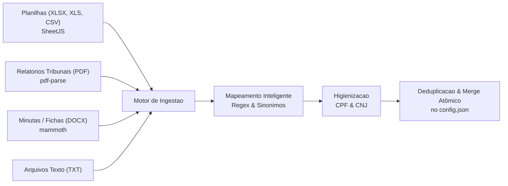
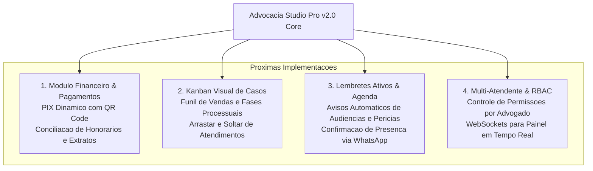

# 🏛️ RESUMO TÉCNICO DE ATUALIZAÇÃO ARQUITETURAL & ENGENHARIA
## Advocacia Studio Pro v2.0 (Alpha 1) — Da Aplicação Desktop ao SaaS Cloud Multi-Ambiente

> **Documento de Alinhamento Técnico de Alta Fidelidade para Sistemas de IA, Engenheiros de Software e Agentes Autônomos.**  
> **Versão da Aplicação:** `2.0.0-alpha.1`  
> **Repositório Oficial:** `https://github.com/danireid123/Advocacia-2.0`  
> **Ambiente de Nuvem (Live):** `https://advocacia-2-0.onrender.com`  
> **Data de Emissão:** Outubro de 2026

---

## 1. STATUS GERAL DA APLICAÇÃO & REPOSITÓRIO

### 1.1. Repositório e Gestão de Versão
O projeto passou por uma transição estrutural decisiva: a evolução de um aplicativo puramente Desktop (Electron) para uma arquitetura híbrida e desacoplada, apta a operar tanto como software executivo local quanto como **servidor autônomo na nuvem (Headless Cloud SaaS)**.

- **Repositório Remoto:** [github.com/danireid123/Advocacia-2.0](https://github.com/danireid123/Advocacia-2.0)
- **Branch Primária:** `main` (rastreada e sincronizada com `origin/main`).
- **Identificador de Versão:** `2.0.0-alpha.1` (definido em `package.json`).
- **Histórico de Commits Recentes:**
  ```text
  a5926a8 feat(server): adicionar sistema keep-alive anti-sleep automatico para render free tier
  6362be8 fix(server): remover --single-process para compatibilidade estavel do chromium no docker
  b382ce5 fix(docker): atualizar para node:20-bookworm-slim e simplificar pacotes do chromium
  3973561 feat(server): espelhamento de sessao LocalAuth, rotas REST status/qr-status e captura de audios multimodais com IA
  1f5608b feat: detector de urgencia (furador de fila), cronologia dos fatos e copilot multi-audios
  dbe77d0 fix(ia): resolve IPC clone serialization and model chain for message enhancer
  8e693a3 feat: acoes de mensagens operantes de verdade e melhoria de mensagens com IA (emojis, termos tecnicos e CTAs)
  e297b2c feat: central de acoes e funcoes inteligentes nas mensagens pre-programadas
  0af2317 feat: captura continua de mensagens e audios enviados apos pausa para atendimento humano
  eb26702 feat: painel expansivel com Ver Resumo do Cliente, historico de mensagens e audios na fila
  ```

### 1.2. Retrocompatibilidade Total (Zero Perda de Dados)
A compatibilidade com as bases da série `v1.8.x` é tratada pelo módulo atômico [`migracao.js`](file:///C:/Users/Daniel/.gemini/antigravity/scratch/Advocacia-2.0/migracao.js). O sistema garante 100% de integridade com arquivos `config.json` preexistentes:

- **Estratégia de Migração Atômica:** O método `migrarConfigV1ParaV2()` inspeciona `versao_schema` e `versao_config`. Se detectar um payload v1, injeta os novos esquemas padrão (agenda de expediente com almoço, fluxo de árvore navegável, templates dinâmicos de atualização processual com tags `{nome}`, `{cpf}`, `{processo}`, `{resumo}`, `{data}`, `{ultima_consulta}`) preservando integralmente todas as customizações, mapas de contatos (`mapaNomes`, `mapaTelefones`), fila de contatos pausados (`pausadosPersistidos`) e lista de contatos ignorados (`contatosIgnorados`).
- **Transação com Backup Automático:** Ao detectar necessidade de migração física no disco, o sistema gera uma cópia segura `config.v1.backup.<timestamp>.json` antes de gravar atomicamente o novo esquema v2.

---

## 2. ARQUITETURA DO SERVIDOR HEADLESS CLOUD (`server.js`)

Para viabilizar a hospedagem contínua em VPS, Docker e nuvens públicas (Render, AWS, DigitalOcean, Oracle Cloud Always Free), foi desenvolvido o [`server.js`](file:///C:/Users/Daniel/.gemini/antigravity/scratch/Advocacia-2.0/server.js). Este componente é **100% desacoplado do Electron**, utilizando apenas a biblioteca padrão do Node.js (`http`, `fs`, `path`, `crypto`, `https`) em conjunto com `whatsapp-web.js` e os motores internos de IA.

```mermaid
flowchart TD
    subgraph Ambientes de Execucao
        Desktop["Desktop Windows (Electron / main.js)"]
        Cloud["Nuvem / Docker / VPS (Headless / server.js)"]
    end

    subgraph Modulos Centrais Compartilhados
        Tradutor["Motor de IA Gemini (tradutorJuridico.js)"]
        Migracao["Modulo de Retrocompatibilidade (migracao.js)"]
        Ingestao["Motor Ingestao Multiformato (motorIngestao.js)"]
        Storage["Persistencia LocalAuth (./wwebjs_auth_session_v2)"]
    end

    subgraph API REST Headless
        R_Root["GET / (Dashboard Web Dark Mode)"]
        R_Health["GET /health & /status (Telemetria JSON)"]
        R_QR["GET /qr (UI Auto-Reload)"]
        R_QRJson["GET /qr-status (Base64 QR JSON)"]
        R_Pausados["GET /pausados (Fila de Transbordo)"]
    end

    Cloud --> Storage
    Cloud --> Tradutor
    Cloud --> Migracao
    Cloud --> API REST Headless
    Desktop --> Storage
    Desktop --> Tradutor
    Desktop --> Migracao
```

### 2.1. Endpoints REST e Painel Integrado

| Endpoint | Método | Descrição e Retorno Técnico |
|---|---|---|
| `/` | `GET` | Dashboard Web dark mode minimalista e responsivo. Apresenta o status da conexão em tempo real, contador de uptime em segundos, total de mensagens processadas e total de clientes na fila de transbordo humano, além de links rápidos para a API e tela de QR Code. |
| `/status` | `GET` | Telemetria completa em JSON estruturado: `status` (`DISCONNECTED`, `QR_READY`, `CONNECTED`), `uptime`, `momentoConexao`, `totalProcessosCadastrados`, `totalMensagensProcessadas`, `contatosPausadosQtd` e o objeto integral `contatosPausados`. |
| `/health` | `GET` | Endpoint de liveness/readiness probe com retorno JSON de código HTTP 200, utilizado por orquestradores (Docker HEALTHCHECK, Kubernetes e Render Health Checks). |
| `/qr` | `GET` | Página HTML dinâmica com auto-reload configurado: exibe a imagem renderizada do QR Code em tempo real ou a mensagem de sucesso e link para status caso o WhatsApp já esteja autenticado. |
| `/qr-status` | `GET` | Endpoint JSON com os campos `{ status, qr, qrDataUrl }`, permitindo que aplicações clientes, microserviços ou painéis externos consumam a imagem do QR Code em Base64 Data URL. |
| `/pausados` | `GET` | Retorna o dicionário completo de clientes que transbordaram para a fila de atendimento humano, incluindo metadados consolidados de mensagens e áudios. |

### 2.2. Sessão Persistente LocalAuth
O cliente WhatsApp Web opera sob a estratégia `LocalAuth({ clientId: 'advocacia-server-session', dataPath: SESSION_PATH })`, armazenando os cookies de sessão, tokens criptográficos e IndexedDB do Chromium em `./wwebjs_auth_session_v2`. Esse diretório é mapeado como volume de disco persistente nos containers, eliminando a necessidade de reescanear o QR Code a cada reinicialização ou novo deploy.

---

## 3. DEPLOY NA NUVEM (RENDER.COM) & OTIMIZAÇÕES DOCKER

### 3.1. Arquitetura do Container Dockerfile Multi-Arch
O deploy foi conteinerizado com suporte multi-arquitetura (`x86_64` e `ARM64`) através do arquivo [`Dockerfile`](file:///C:/Users/Daniel/.gemini/antigravity/scratch/Advocacia-2.0/Dockerfile):

```dockerfile
FROM node:20-bookworm-slim

ENV DEBIAN_FRONTEND=noninteractive

RUN apt-get update && apt-get install -y --no-install-recommends \
    chromium \
    fonts-liberation \
    fonts-freefont-ttf \
    ca-certificates \
    && rm -rf /var/lib/apt/lists/*

ENV PUPPETEER_SKIP_CHROMIUM_DOWNLOAD=true \
    PUPPETEER_EXECUTABLE_PATH=/usr/bin/chromium \
    NODE_ENV=production \
    PORT=3000

WORKDIR /app
COPY package*.json ./
RUN npm install --omit=dev
COPY . .
RUN mkdir -p /app/wwebjs_auth_session_v2 /app/cache
VOLUME ["/app/wwebjs_auth_session_v2", "/app/cache"]
EXPOSE 3000

HEALTHCHECK --interval=30s --timeout=10s --start-period=60s --retries=3 \
    CMD node -e "require('http').get('http://localhost:3000/health', (r) => { process.exit(r.statusCode === 200 ? 0 : 1); }).on('error', () => process.exit(1));"

CMD ["npm", "run", "server"]
```

### 3.2. Diagnósticos e Correções Críticas Realizadas

1. **Correção do Erro `apt-get` Exit Code 100:**
   - *Causa-raiz:* Repositórios de imagens slim Debian baseadas em distribuições anteriores tentavam baixar fontes asiáticas legadas (`fonts-ipafont-gothic`, `fonts-wqy-zenhei`, `fonts-thai-tlwg`, `fonts-kacst`) que foram descontinuadas ou renomeadas no repositório oficial do Debian 12 (Bookworm), gerando falha fatal no build do Docker.
   - *Solução aplicada:* Atualização da base para `node:20-bookworm-slim` e simplificação do pacote de fontes para `fonts-liberation`, `fonts-freefont-ttf` e `ca-certificates`, garantindo compilação ultra-rápida, segura e sem erros.

2. **Eliminação do Crash de Execução do Puppeteer / Chromium no Linux:**
   - *Causa-raiz:* A flag `--single-process` era empregada para economizar memória em ambientes legados, porém em instâncias Linux conteinerizadas sem privilégios de CPU direta (como no Render Free Tier), ela disparava violação de segmentação e falhas do `crashpad` do Chromium, retornando `exit code null` na inicialização do browser.
   - *Solução aplicada:* Remoção completa da flag `--single-process` e parametrização segura de sandbox no Puppeteer:
     ```javascript
     puppeteer: {
         headless: true,
         executablePath: execPath,
         args: [
             '--no-sandbox',
             '--disable-setuid-sandbox',
             '--disable-dev-shm-usage',
             '--disable-accelerated-2d-canvas',
             '--no-first-run',
             '--no-zygote',
             '--disable-gpu',
             '--disable-software-rasterizer',
             '--disable-extensions'
         ]
     }
     ```

3. **Deploy em Produção Concluído com Sucesso:**
   - Aplicação compilada, testada e ativa na URL pública: [https://advocacia-2-0.onrender.com](https://advocacia-2-0.onrender.com)

4. **Sistema Keep-Alive Anti-Sleep (Autonomia 24/7):**
   - No plano gratuito do Render.com, instâncias web entram em hibernação automática caso não recebam tráfego HTTP por 15 minutos consecutivos.
   - Foi implementado no [`server.js`](file:///C:/Users/Daniel/.gemini/antigravity/scratch/Advocacia-2.0/server.js#L759-L777) o mecanismo `iniciarKeepAliveAntiSleep()`. O sistema realiza requisições HTTPS autônomas preventivas a cada 10 minutos para `https://advocacia-2-0.onrender.com/health`, mantendo o processo do container em execução ininterrupta.

---

## 4. MOTOR MULTIMODAL DE IA & TRANSBORDO HUMANO AVANÇADO

O módulo [`src/ia/tradutorJuridico.js`](file:///C:/Users/Daniel/.gemini/antigravity/scratch/Advocacia-2.0/src/ia/tradutorJuridico.js) opera como o cérebro cognitivo do sistema:

### 4.1. Comunicação Direta REST com Google Gemini (Sem SDK Pesado)
- Chamadas HTTP POST nativas contra a API `https://generativelanguage.googleapis.com/v1beta/models/{modelo}:generateContent?key={apiKey}`.
- Encadeamento resiliente de modelos padrão (`gemini-3.5-flash`, `gemini-3.5-flash-lite`, `gemini-flash-lite-latest`, `gemini-1.5-flash`).
- Camada de Cache MD5 em disco (`gemini_cache.json`) com política LRU de até 500 registros úteis e descarte higiênico de binários pesados de áudio.
- Timeout rígido de tolerância de 2.800 ms com fallback heurístico instantâneo.

### 4.2. Guardrails Éticos da OAB (Provimento 205/2021)
O system instruction impõe diretrizes estritas de compliance jurídico:
- Tradução de jargões técnicos para linguagem humana, acolhedora e empática em no máximo 3 frases curtas.
- **Proibições Incondicionais:** Vedada qualquer promessa de prazos judiciais para liberação ou alvarás, vedada a garantia de vitória ou ganho de causa, e proibida a menção de valores monetários como certos.

### 4.3. Processamento Multimodal de Áudios de WhatsApp
- Quando um cliente envia um áudio (PTT/voz), o sistema realiza o download da mídia via `msg.downloadMedia()`.
- O buffer de áudio é enviado diretamente ao Gemini Multimodal como `inlineData` no MIME type correto (`audio/ogg`, `audio/mp4`, etc.).
- A IA extrai e devolve em payload JSON estruturado:
  1. `transcricao`: Texto fiel do que foi falado.
  2. `resumo`: Síntese executiva do relato fático para o advogado.
  3. `sugestoesResposta`: 3 opções estratégicas de respostas prontas para o atendente humano disparar com 1 clique.
  4. `nivelUrgencia`: Classificação do caso.
  5. `motivoUrgencia`: Justificativa jurídica do grau atribuído.
  6. `cronologiaFatos`: Linha temporal sequencial dos acontecimentos narrados.

### 4.4. Transbordo Humano Cumulativo e Detector de Urgência
- **Acúmulo Não-Destrutivo:** Se o cliente envia mensagens de texto ou múltiplos áudios após já estar na fila de transbordo, o sistema concatena cumulativamente o histórico (`historicoMensagens` e `historicoAudios`), reprocessando a inteligência para enriquecer o dossiê sem apagar as mensagens anteriores.
- **Classificação em 4 Níveis de Urgência:**
  - `CRITICA`: Prazos fatais em 24h/48h, mandados de prisão, busca e apreensão, busca de menores, audiência no mesmo dia.
  - `ALTA`: Citações e intimações recentes, liminares deferidas/indeferidas, bloqueios judiciais de contas (SISBAJUD).
  - `MEDIA`: Dúvidas sobre andamento de processo comum, solicitação de certidões, envio de documentação complementar.
  - `BAIXA`: Cumprimentos de rotina, agradecimentos ou dúvidas genéricas.
- **Furador de Fila Inteligente:** Contatos classificados como `CRITICA` furam a ordem de espera tradicional, sendo destacados no topo da fila e ativando alertas prioritários.

### 4.5. Melhoria de Mensagens ("✨ Melhorar com IA") & Notificações
- **Botão "✨ Melhorar com IA":** No painel de composição do operador humano, a IA reescreve a resposta digitada pelo atendente, enriquecendo a redação com emojis sóbrios, polidez institucional, clareza técnica e direcionamento para os próximos passos (CTA).
- **Sintetizador de Notificações Sonoras Executivas:** Módulo [`src/audio/audioAlert.js`](file:///C:/Users/Daniel/.gemini/antigravity/scratch/Advocacia-2.0/src/audio/audioAlert.js) baseado inteiramente na **Web Audio API** do navegador. Não utiliza arquivos de áudio externos nem decodificadores pesados:
  - *Sino de Transbordo Humano:* Acorde harmônico Mi5 $\rightarrow$ Lá5 (659.25Hz $\rightarrow$ 880Hz) com envelope acústico suave.
  - *Alerta de Urgência Crítica:* Tríade rápida modulada Lá5 $\rightarrow$ Dó6 $\rightarrow$ Mi6 para chamar atenção imediata da equipe jurídica.
  - *Notificações Nativas do Windows:* Disparo integrado via Electron Notification API para o desktop.

---

## 5. MOTOR DE INGESTÃO MULTIFORMATO DE DADOS JURÍDICOS

O módulo [`src/ingestao/motorIngestao.js`](file:///C:/Users/Daniel/.gemini/antigravity/scratch/Advocacia-2.0/src/ingestao/motorIngestao.js) e [`src/ingestao/higienizarBase.js`](file:///C:/Users/Daniel/.gemini/antigravity/scratch/Advocacia-2.0/src/ingestao/higienizarBase.js) formam a camada de extração e tratamento de dados:



### 5.1. Formatos Suportados
- **Planilhas (`.xlsx`, `.xls`, `.csv`):** Parsing via biblioteca SheetJS (`xlsx`).
- **Documentos PDF (`.pdf`):** Extração de texto via `pdf-parse` com detecção de padrões de processos dos tribunais (PJe, e-SAJ, Projudi, Eproc).
- **Documentos Word (`.docx`):** Leitura de fichas e minutas contratuais via `mammoth`.
- **Textos (`.txt`):** Ingestão direta via parsing delimitado ou posicional.

### 5.2. Mapeamento Semântico e Higienização de Dados
- **Reconhecimento Heurístico de Cabeçalhos:** Mapeamento automático por dicionário de sinônimos e regex:
  - *Processo:* `/(processo|numero|cnj|npu|proc|autos)/i`
  - *Nome:* `/(nome|cliente|autor|reu|requerente|interessado)/i`
  - *CPF:* `/(cpf|doc|documento|cpf_cnpj)/i`
  - *Andamento/Resumo:* `/(resumo|andamento|movimentacao|situacao|fase|status|historico)/i`
- **Sanitização de Documentos:**
  - Extração estrita de dígitos de CPF com preenchimento de zeros à esquerda (11 dígitos) e formatação padrão `000.000.000-00`.
  - Normalização da numeração única de processo conforme Resolução 65/2008 do CNJ (`NNNNNNN-DD.AAAA.J.TR.OOOO`).
  - Deduplicação atômica e merge inteligente com a base em memória e em disco (`config.json`).

---

## 6. VISÃO DE FUTURO & PRÓXIMOS PASSOS (ROADMAP SAAS / ERP)

A arquitetura do Advocacia Studio Pro v2.0 foi desenhada para expandir além do atendimento automatizado, transformando-se em uma suíte completa de gestão de escritórios de advocacia:



1. **Módulo Financeiro & Cobrança PIX:**
   - Integração com APIs bancárias / gateways de pagamento para emissão de cobranças automáticas de honorários contratuais e sucumbenciais via PIX (QR Code e Copia e Cola) diretamente no chat do WhatsApp.
2. **Kanban Visual de Atendimento e Casos:**
   - Interface em colunas interativas estilo CRM/Kanban (`Novo Contato` $\rightarrow$ `Triagem IA` $\rightarrow$ `Atendimento Humano` $\rightarrow$ `Proposta / Contrato` $\rightarrow$ `Em Andamento`).
3. **Lembretes Ativos e Confirmação de Presença:**
   - Robô ativo de agendamento que notifica clientes 48h e 24h antes de audiências presenciais, perícias médicas e reuniões, solicitando confirmação de presença (Sim/Não) e atualizando o status na agenda do escritório.
4. **Painel Multi-Operador em Nuvem com Permissões (RBAC):**
   - Transição do painel local para interface web multiusuário sincronizada via WebSockets, permitindo que múltiplos sócios e estagiários operem concomitantemente sobre a mesma sessão de WhatsApp em nuvem.

---

## 7. MATRIZ DE CONFIGURAÇÕES E VARIÁVEIS DE AMBIENTE

| Variável | Padrão | Descrição |
|---|---|---|
| `PORT` | `3000` | Porta HTTP utilizada pelo servidor web headless. |
| `GEMINI_API_KEY` | *(Configurável)* | Chave de API do Google Gemini para transcrição de áudio, copilot e tradução. |
| `RENDER_EXTERNAL_URL`| `https://advocacia-2-0.onrender.com` | URL pública da aplicação para o sistema preventivo de auto-ping Keep-Alive. |
| `SESSION_PATH` | `./wwebjs_auth_session_v2` | Caminho do diretório de persistência dos tokens e cookies do WhatsApp Web. |
| `CONFIG_PATH` | `./config.json` | Caminho do arquivo de configuração persistente e base de dados processuais. |
| `PUPPETEER_EXECUTABLE_PATH` | `/usr/bin/chromium` (no container) | Caminho do executável do navegador Chromium utilizado pelo Puppeteer. |

---
*Documentação técnica homologada e pronta para consumo por modelos de IA e equipes de engenharia.*
